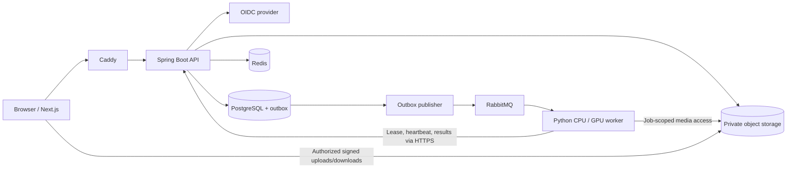

# Master development prompt: full-person video replacement application

Revision 3 — 2026-11-06: Apple Silicon developer workflow with GPU-only production inference, a Mac-or-GPU training track, an open-dataset registry, and a trained-model-to-production pipeline are explicit requirements. Priorities and phases are reordered so the model work is verified first.

Revision 2 — 2026-10-28: RabbitMQ dispatch, Redis caching and rate limiting, OIDC identity, secure deployment, observability, and supply-chain tooling are explicit implementation requirements.

Use this document as the implementation brief for an AI coding assistant. Build the application described below in the current repository. This is an application-development task using existing pretrained video models, not a request to train a foundation model from random weights. Adapter fine-tuning of the pinned model on open or consented data is in scope as the separate training track in section 15.

## 0. Environment, priorities, and how to read this brief

### Target environments

| Environment | Hardware / OS | What it is used for |
| --- | --- | --- |
| Developer workstation | Apple Silicon Mac (M1-class, macOS, arm64) | Daily development of web, API, broker, cache, identity, storage, mock worker, and tests; dataset preparation; training smoke tests; optional experimental native runs |
| Production GPU server | Linux x86_64 with an NVIDIA GPU (CUDA) | Real Wan-Animate inference, authoritative evaluation, and real LoRA training |
| Production CPU host | Ordinary Linux host | Web, API, Caddy, identity, and control-plane services |
| CI | Linux CPU runners | Lint, unit and Testcontainers integration tests, scans, image builds |

Training can run on either the Mac or a GPU server. Production inference runs only on GPU servers. Design for this split from the first commit: the same repository, configuration schema, and commands must work on the Mac for development and on a GPU server for real work, with the device chosen by an explicit profile rather than by editing code.

### Hardware tiers and what may be claimed

| Tier | Real Wan-Animate-14B inference | Preprocessing (segmentation, pose, face) | Adapter training | May satisfy acceptance gates |
| --- | --- | --- | --- | --- |
| `cuda` (Linux + NVIDIA) | Supported target | Supported target | Supported target: real LoRA on Animate-14B, subject to Phase 0 verification | Yes, once measured |
| `mps` (Apple Silicon, native process) | Not assumed feasible; optional experimental spike only | Run on MPS or CPU only where Phase 0 verifies the specific tool; expect slow runs | Pipeline smoke tests and small-scale runs; real 14B training only if Phase 0 proves it and records measurements | No |
| `coreml` | Not a target for the 14B model | Optional, only for small models that are converted and parity-tested against PyTorch | None | No |
| `cpu` | Mock backend only | Tiny fixtures only | Tiny smoke fixtures only | No |

Rules that follow from the table:

- Linux containers on macOS cannot use the Apple GPU (Metal/MPS); verify this for the container runtime in use. Anything that needs MPS or MLX runs as a native host process managed by `uv`. The container path on a Mac is CPU/mock plus a remote GPU worker.
- Docker images built on an Apple Silicon Mac are arm64. GPU workers need `linux/amd64` images. Build them in CI or with an explicit multi-platform build, and never deploy an arm64 image to a GPU host.
- Do not state or imply that an Apple Silicon or Core ML run is equivalent to the CUDA path. Record `device_type`, framework versions, and dtype in every manifest, and let measurements decide any claim.
- Real inference quality, benchmarks, and the MVP acceptance gate are validated only on the `cuda` tier.

### Execution priorities

Work toward the uncertain, high-value parts first. Label every requirement in `docs/IMPLEMENTATION_STATUS.md` with one of these tiers:

- **P0, core flow:** project, upload, selection, preprocessing, mock and real generation, result download, and job durability. The Phase 0 spikes (CUDA, Apple Silicon, training, and dataset) start immediately and run in parallel with Phase 1.
- **P1, hardening gate:** deep observability dashboards, Cosign signing, SBOM, k6 load tests, ClamAV, backup/restore drills, and Grafana alerts. Implement the interfaces and basic metrics early, and complete the full tooling in Phase 4, not before the real preview works.
- **P2, deferred:** items in the later-enhancements list.

OIDC, RabbitMQ with the outbox, and Redis remain part of the first complete application slice, as stated in section 3.

## 1. Your roles and working method

Act as a principal engineer coordinating these responsibilities:

| Role | Responsibility |
| --- | --- |
| Product engineer | Define a usable, achievable MVP and maintain acceptance criteria. |
| ML/video engineer | Validate model capabilities, implement preprocessing and real inference, measure quality and hardware usage. |
| Frontend engineer | Implement the Next.js interface, media selection, masks, settings, progress, and results. |
| Backend engineer | Implement Spring Boot APIs, OIDC integration, ownership, PostgreSQL persistence/outbox, RabbitMQ dispatch, Redis caching, and durable job orchestration. |
| Platform engineer | Deliver reproducible local environments, GPU images, cloud deployment instructions, and recovery procedures. |
| QA/security reviewer | Maintain a threat model and verify access controls, uploads, broker/cache isolation, supply-chain checks, failure recovery, and evidence for completion claims. |
| Training/MLOps engineer | Build the dataset registry and tools, training profiles for Mac and GPU, the evaluation gate, and adapter registration, promotion, and rollback. |

These are responsibilities, not a requirement to introduce separate services for every role. If the environment supports subagents and repository instructions permit them, you may delegate independent implementation or review work with clear file ownership. Otherwise perform the roles sequentially. One lead must integrate the work and verify the complete user journey.

Inspect the repository and applicable instructions first. Preserve unrelated user work. Make reasonable implementation choices, record them, and proceed. Ask questions only when a missing decision genuinely blocks progress. Do not stop after producing a plan, scaffolding, mock screens, or an architecture description.

Work in the phases below. Maintain `docs/IMPLEMENTATION_STATUS.md` with completed work, evidence, commands run, remaining work, and blockers. If interrupted, continue from that file and the repository state. Report unavailable credentials, GPUs, or assets accurately; finish independent work without pretending the blocked checks succeeded.

Implement deployment artifacts and runbooks, but do not create paid infrastructure, launch paid training, or publish externally without the user's authorization. Do not hide material limitations behind a successful mock demonstration.

## 2. Product objective and exact behavior

Build a private video-editing application provisionally called **MotionMirror**.

A user uploads a source dance video, selects the dancer, and uploads photographs of themselves. The application generates an edited video in which the user's entire appearance replaces the selected dancer while following the source performance.

An illustrative example is a Michael Jackson dance clip with the user replacing the dancer. Do not bundle celebrity videos or scraped photographs as test data. Use user-supplied or appropriately licensed fixtures.

The replacement includes face, hair, visible body appearance, clothing, and footwear. Preserve source choreography, timing, camera movement, scene, and original audio as far as the selected model and compositing pipeline allow. Exact anatomy, likeness, foot contact, and frame-perfect movement are quality targets, not guarantees.

Distinguish three asset roles throughout the schema and UI:

1. **Driving video:** source of motion, scene, and timing.
2. **Source selection frames:** exact frames and annotations used to identify the original dancer.
3. **Target appearance references:** photographs of the replacement person and outfit.

A face close-up alone is insufficient to specify a complete outfit. Ask the user to select one clear full-body primary reference. Accept supplementary front/back/side/three-quarter and face photographs, preferably in the same outfit. Never describe an ordinary image list or collage as a reconstructed 3D person.

## 3. Scope: build a staged MVP

### MVP boundaries

- Upload a source clip up to 30 seconds; provide trimming or a clear duration error for longer uploads.
- Start real-model validation with a 3–5 second preview, then support the entire accepted clip.
- Support one selected person per job. Other people may be present but are not additional edit targets.
- Start with continuous single-shot clips. Detect cuts; require explicit reselection per shot before allowing multi-shot processing, or reject multi-shot input with an actionable explanation. Never silently track across unrelated shots.
- Accept common MP4/MOV inputs when FFmpeg can decode them. Use configurable byte, duration, dimension, and decoded-frame limits.
- Accept JPEG/PNG/WebP references and normalize orientation and color handling.
- Provide mask preview and correction, positive/negative prompts, supported presets, seed, and a limited advanced panel.
- Produce downloadable MP4 output, original/output comparison, processing metadata, and a job history.
- Provide real OIDC authentication, asset ownership, RabbitMQ dispatch, and Redis integration in the first complete application slice; cloud hardening is a separate acceptance gate.
- Provide both a clearly labeled mock mode and a genuine GPU inference mode.
- Develop on Apple Silicon Macs and run real inference on CUDA GPU servers. The Mac path must never be required to produce real output.

### Later enhancements

Defer simultaneous multi-person replacement, automatic multi-shot re-identification, arbitrary multi-view conditioning, new identity training per user, 4K output, real-time streaming, billing, mobile apps, Kubernetes, and multi-region infrastructure.

Customization of presets and backend configuration is required in the MVP. Operator-run adapter (LoRA) fine-tuning of the pinned Wan-Animate checkpoint on open or consented datasets, and deploying the resulting adapter to production, is a required **training track** (section 15) that runs independently of the application MVP. Per-user identity training at upload time remains deferred. Training a foundation model from scratch is out of scope.

## 4. Required technology and service boundaries

Use the following opinionated stack. Implement the listed core tools; do not merely mention them in a README. An equivalent may replace a tool only for a documented compatibility or repository constraint.

| Layer | Tools | Implementation responsibility |
| --- | --- | --- |
| Web | Next.js App Router, React, TypeScript strict mode, pnpm, Tailwind CSS, accessible shadcn/ui or Radix components | Media workflow and responsive UI; keep business authorization in Spring Boot |
| Forms and data | React Hook Form, Zod, TanStack Query, generated OpenAPI TypeScript client | Validate user input, manage query lifecycle, backoff, and cancellation; repeat authoritative validation server-side |
| API | Spring Boot, Java 21 LTS, Maven Wrapper, Spring MVC, Bean Validation, Spring Security, springdoc/OpenAPI | Modular application API, consistent errors, roles, ownership, worker authorization |
| Persistence | PostgreSQL, Spring Data JPA, explicit SQL where queue/outbox concurrency needs it, HikariCP, Flyway | Canonical metadata, durable attempts, outbox, sessions, and migrations |
| Messaging | RabbitMQ, Spring AMQP, Python aio-pika | Versioned JSON task messages, durable routing, publisher confirms, manual acknowledgements, dead-letter handling |
| Cache | Redis, Spring Data Redis/Lettuce | Cache-aside metadata, short-lived progress, atomic rate limits; never the sole job or authorization authority |
| Identity | Keycloak for reproducible local OIDC; the same deployment or a compatible managed OIDC provider in cloud | Browser login and worker service accounts; reuse standard protocols rather than implement a password/JWT issuer |
| ML worker | Python, uv/lockfile, Pydantic, PyTorch, verified Diffusers or official model runtime, FFmpeg/ffprobe | Preprocessing, actual inference, artifact validation, metrics, and isolated attempts |
| Media | Private S3-compatible storage and an SDK with presigning support | Immutable owned assets, quarantine, processing artifacts, results, and lifecycle rules |
| Local storage | Pinned MinIO development image or a verified equivalent | Local S3 compatibility; verify current image availability and licensing |
| Edge/runtime | Docker multi-stage builds, Docker Compose, Caddy reverse proxy/TLS, separate CPU/GPU images | Same-origin browser routing, internal service networks, reproducible deployment |
| Resilience | Bounded client timeouts, Resilience4j in Java where useful, bounded Python retries | Circuit breaking and retry budgets for transient faults without repeating non-idempotent effects |
| Observability | OpenTelemetry, Spring Actuator/Micrometer, Prometheus, Grafana, structured logs | Correlation and operational visibility; optional local observability profile |
| Testing | JUnit, Testcontainers, pytest, Vitest/Testing Library, Playwright, k6 for control-plane load | Real service integration tests, media logic tests, UI journeys, and bounded load tests |
| Delivery/security | GitHub Actions or repository-native CI, Ruff, type checking, ESLint, Gitleaks, Trivy, Semgrep, CycloneDX SBOM, Cosign | Repeatable checks, dependency/container review, artifact provenance, and verified deployment artifacts |
| Training | Pinned DiffSynth-Studio (or the verified official trainer), PyTorch with CUDA or MPS, safetensors, a dataset registry, and evaluation scripts | Adapter fine-tuning in an isolated environment; never part of the inference image |
| Apple Silicon development | arm64 container images, native `uv` environments, PyTorch MPS, optional MLX, optional Core ML for small models | Daily development on a Mac without a GPU; real inference through a remote CUDA worker |

FastAPI may expose a small private worker health/metrics interface if necessary; it must not become a second public application API. Do not add Celery alongside the explicit Spring AMQP/aio-pika contract, Kafka, a service mesh, or Kubernetes to the MVP.

Select compatible, supported versions from official documentation at implementation time. Pin exact package versions and model revisions after the initial compatibility spike; do not leave production dependencies or images floating on `latest`.

Spring Boot owns user authorization, projects, asset metadata, jobs, retries, leases, and canonical status. Next.js is the UI, not a competing business backend. Python consumes RabbitMQ tasks, executes media work, and reports results to Spring Boot over authenticated HTTPS. Python must not independently mutate application database state. Redis access remains behind Spring Boot; GPU workers do not need direct database/cache access.

Do not put video binaries in PostgreSQL. Store object keys, sizes, checksums, media metadata, provenance, and relationships there. Do not store signed URLs as permanent identifiers.

RabbitMQ is the dispatch transport. PostgreSQL is the durable source of truth and contains a transactional outbox. Redis is a performance and rate-limiting layer. Workers do not poll a PostgreSQL-backed claim endpoint for new tasks; they receive RabbitMQ deliveries, then call a job-specific API to acquire a fenced execution lease before touching media.



The publisher runs as a Spring Boot component initially, with database coordination if API replicas exist. Keep observability and security tools as development/deployment capabilities rather than splitting the application into unnecessary microservices.

## 5. Phase 0: verify the model before building around it

Evaluate **Wan2.2-Animate-14B replacement mode** as the initial candidate. It is a baseline to validate, not a mandate to use an incompatible or unavailable checkpoint. Compare alternatives only if an actual limitation prevents meeting the MVP.

Read the official repository, preprocessing guide, checkpoint card, and the documentation/source of the exact runtime version. Confirm:

- Replacement mode is implemented and accepts the required source/background, mask, body-motion, facial-motion, and appearance inputs.
- Exact model identifiers, revisions, required auxiliary checkpoints, and file formats.
- Required pose/face extraction and segmentation tools; auxiliary dependencies may have different licenses and hardware needs.
- Whether the runtime really supports positive prompts, negative prompts, guidance, segment continuation, adapters, and low-memory settings.
- Mask polarity, frame-count constraints, resolution divisibility, normalization, color space, and source/reference resizing rules.
- GPU architecture, precision support, CPU RAM, cache and scratch disk requirements, and version compatibility.
- Model and dependency licensing and any applicable redistribution restrictions, with source links. Do not infer all dependencies have the repository's license.

Implement a small CLI inference spike before tightly coupling the product to one runtime. It must accept a short source clip and a primary target reference, produce preprocessing artifacts, and attempt actual replacement.

Add three further spikes with recorded outcomes, including negative ones:

1. **Apple Silicon spike.** On the Mac, determine which preprocessing tools (segmentation, pose, face) run on MPS or CPU, and whether Animate-14B can run at all in a native process, with measured memory and time at a tiny resolution and frame count. Report unsupported operators, dtype limits, and CUDA-only dependencies. A failure is a valid result: record it and rely on the remote CUDA worker. Treat Core ML only as a possible route for small preprocessing models.
2. **Training spike.** Follow section 15.1 and run a tiny training smoke test on each available profile.
3. **Dataset spike.** Fetch a small licensed sample, run the validator, and build a few training samples with the construction pipeline in section 15.4.

Record all results in `docs/MODEL_CAPABILITIES.md`, `docs/MAC_APPLE_SILICON.md`, `docs/TRAINING.md`, and the benchmark manifest.

Record findings in `docs/MODEL_CAPABILITIES.md`, `docs/DEPENDENCY_MATRIX.md`, and a benchmark manifest. A GPU-unavailable environment may validate imports/contracts and finish other work, but must mark actual inference and performance as unverified.

Known issues to verify against the pinned implementation:

- Baseline Wan-Animate workflows center on one character image. A batch/list argument is not evidence of multi-view identity fusion. Store all uploaded views but explicitly identify which image was consumed by a generation.
- Negative prompts only influence output when the selected guidance path uses them. Do not accept a negative prompt, run with guidance disabled, and claim it was applied. Expose the effective settings and reject incompatible combinations or adjust them transparently within validated limits.
- Replacement pose retargeting may be disabled by default to preserve interactions with the environment. Do not silently enable it to match the user's body proportions. Treat retargeting as experimental until the actual runtime and evaluation support it.
- Do not transfer memory requirements, LoRAs, or optimization flags from similarly named Wan T2V/I2V models to Animate without checking compatibility.
- Do not claim that 30 seconds can be passed as one unrestricted tensor sequence. Verify the runtime's segmentation/continuation behavior.

## 6. Model integration and customization contract

Create a narrow Python adapter interface, for example:

```python
class VideoReplacementBackend(Protocol):
    def capabilities(self) -> BackendCapabilities: ...
    def validate(self, request: GenerationRequest) -> ValidationResult: ...
    def prepare(self, request: GenerationRequest) -> PreparedInputs: ...
    def generate(self, inputs: PreparedInputs, context: JobContext) -> GenerationResult: ...
    def release(self) -> None: ...
```

The signatures are an architectural sketch; implement complete typed contracts rather than copying undefined types. `JobContext` must support progress, heartbeat/cancellation awareness, and an attempt-scoped workspace.

Implement:

- `MockReplacementBackend`: deterministic CPU fixture processing with conspicuous `MOCK / NO AI REPLACEMENT` labeling in UI, manifests, and output frames. It must not download heavy weights or import CUDA-only modules.
- `WanAnimateReplacementBackend`: verified real inference using the pinned supported runtime. It targets CUDA. A Mac-native backend is registered only if the Phase 0 spike shows it works, and then as `experimental` with `device_type=mps`; it cannot satisfy the acceptance gate.
- A backend registry configured by trusted deployment settings. A future backend must not require rewriting the UI/job system.

Capabilities should include supported prompt/guidance modes, primary/multiple reference support, supported precisions, dimensions/frame constraints, continuation modes, adapter compatibility, and experimental flags. Separate static capabilities from worker readiness and measured hardware suitability. Include `device_type` (`cuda`, `mps`, `cpu`), flags for training and adapter-loading support, and the adapter revisions currently loaded.

Provide versioned YAML/JSON presets such as `preview` and `standard`, with validated defaults for resolution, frame rate policy, inference steps, guidance, seed, segment length, continuation frames, mask expansion/feathering, and audio retention. Use reference-conditioning or strength controls only when the backend actually implements them.

Validate configuration in both Spring Boot and Python using a shared versioned contract. Reject unknown/unsupported options. Persist requested settings, effective settings, model revision, adapter hashes, runtime versions, input checksums, and output checksum per run.

Support operator-controlled model paths/cache roots, offloading, and compatible precision settings. Do not allow public requests to specify arbitrary filesystem paths, Python modules, shell arguments, remote model code, or arbitrary downloadable checkpoint URLs.

For adapter/LoRA customization, implement discovery and compatibility validation first. Load only trusted, explicitly configured compatible adapters using a supported runtime path; prefer safetensors. Record the expected base revision, target modules, format, hash, scale, and license. If the chosen runtime has no verified compatible adapter path, return a clear unsupported capability instead of a nonfunctional toggle.

## 7. Video processing and temporal consistency

Implement this explicit processing flow:

1. Validate and probe uploaded media on the server. Inspect actual content, not just filename/MIME headers. Record original dimensions, rotation, rational time base/frame rate, timestamps, duration, and audio streams.
2. Normalize orientation and decoding into a documented processing format. Preserve aspect ratio with padding/cropping rules the user can preview. Retain the mapping between original display coordinates and model input coordinates.
3. Generate source thumbnails/keyframes. Store selected frame index plus source timestamp and the exact asset revision. Do not rely on rounded floating-point timestamps alone for identity.
4. Let the user select a person with points/box/paint. Segment and propagate masks using the verified preprocessing pipeline or SAM 2. Store user corrections as a new selection revision.
5. Extract synchronized body-pose and facial-motion controls required by the backend. Keep original appearance images out of target identity conditioning unless the backend requires specific motion crops.
6. Show a mask/pose preview before expensive generation. Support positive/negative selection points or paint correction on keyframes and re-propagation. Recompute affected cached artifacts when selection changes.
7. Prepare the primary full-body target image and record other references as supplementary unless a real multi-view adapter consumes them.
8. Generate short segments using the model's supported continuation mechanism. Prefer native previous-segment conditioning; document valid segment lengths and boundary-frame accounting. If this is unavailable, do not claim a naive concatenation is temporally coherent.
9. Preserve foreground occluders and scene pixels where possible. Allow the edit region to cover the original silhouette and necessary replacement extent. Explain that changing body shape, hair, clothing, shadows, and reflections can require a larger region.
10. Composite the generated region against the original using the validated mask and soft edges as appropriate. Do not clip generated hair/limbs with the original tight silhouette. Record limitations when reconstruction behind occluders is unreliable.
11. Join segments with correct timestamp/frame accounting. Avoid unconditional crossfades that create double limbs or ghosting. Do not promise that optical flow or interpolation automatically repairs identity discontinuities.
12. Restore original audio aligned to the selected trim; handle silent inputs. Encode a broadly playable MP4 profile and record the codec settings.
13. Probe the output, verify duration/dimensions/audio presence, upload it, and only then mark the job successful.

Keep processing FPS separate from input FPS and output FPS. If downsampling motion controls, use timestamp-based resampling and state the effect. A higher export FPS does not add motion detail by itself. For the supported continuous-shot path, target output duration within one output frame of the selected source duration; preserve audio alignment under variable-frame-rate inputs and rotation metadata.

Cache reusable preprocessing by source checksum, selection revision, configuration, and tool/model revision. Do not regenerate masks simply because the user changes the target photo or prompt. Keep temporary files isolated per job attempt; clean them on success, cancellation, and failure according to retention policy.

Quality review should explicitly inspect likeness, outfit continuity, body-motion alignment, spins/back views, hands, feet, occlusion, flicker, mask edges, boundary transitions, background changes, and audio sync.

## 8. Frontend workflows

Build a polished but compact interface with:

1. Login and project list.
2. Project creation and source video upload/validation.
3. Trim selection, source frame scrubber, and dancer-selection canvas.
4. Target reference gallery with view labels and one primary full-body image.
5. Preprocessing progress, mask/pose preview, and correction controls.
6. Generation settings with positive/negative prompt fields, presets, seed, and backend-supported advanced options.
7. Short preview generation and then full accepted-clip generation.
8. Job status, cancellation, failure explanation, retry, and output history.
9. Synchronized source/output playback, download, settings manifest, and deletion controls.

Use accessible form labels, keyboard actions, loading/empty/error states, cancellation feedback, upload progress, and responsive layouts. Keep raw model internals out of the default workflow; put useful technical details in an expandable details panel.

Communicate which reference images were actually used. Clearly distinguish `mock`, `real`, and `experimental`. Do not present a supplementary photograph as applied if it was only stored. Explain unsupported poses/clip types without claiming certainty about generated quality. When a preset uses a trained adapter, show the adapter name, revision, and evaluation status, and label it experimental until it is promoted.

Use typed API clients generated from or checked against OpenAPI. Poll job status with sensible backoff for MVP; SSE is optional if it meaningfully improves the UX and is tested across proxies. Do not fabricate percentages or ETAs. Show the real stage and available segment/frame counts; estimates must be labeled.

## 9. Spring Boot APIs and PostgreSQL model

Implement a modular monolith with these logical modules: identity, projects, assets, selections, jobs, presets, model registry (including trained adapters), and worker integration.

Suggested tables, adjusting names as appropriate:

- `users` keyed by stable OIDC issuer plus subject, and server-side Spring Session JDBC sessions. Do not use mutable email as the ownership identifier.
- `projects` with owner and lifecycle status.
- `assets` with role, owner/project, immutable object key, checksum, size, validation status, and media metadata.
- `appearance_profiles` and `reference_images` with view label and primary reference.
- `subject_selections` with source revision, frame/timestamp, coordinate mapping, annotations, and version.
- `preprocessing_artifacts` with cache key, configuration, and artifact references.
- `generation_jobs` with kind, state, requested/effective settings, idempotency key, cancellation flag, and timestamps.
- `job_attempts` with worker, lease token/generation, lease expiry, heartbeat, stage, timings, and failure details.
- `job_events` for an ordered diagnostic history.
- `outputs` with artifact references and reproducibility metadata.
- `model_configs`/`presets` with immutable revision or versioned definitions.
- `model_adapters` with adapter id, base model id and revision, artifact key, hash, target modules, rank and scale, license, dataset versions, `trained_on`, evaluation manifest reference, and lifecycle state (`REGISTERED`, `EVALUATED`, `STAGED`, `PROMOTED`, `DEPRECATED`).
- `adapter_promotions` with preset revision, adapter, actor, previous revision for rollback, and timestamp.
- `outbox_events` with unique event ID, schema version, aggregate/job ID, dispatch generation, payload, publication state, and retry timestamps.
- `worker_deliveries` or equivalent inbox/dispatch records with durable event deduplication and lease state.
- `audit_events` for significant authorization, admin, generation, and deletion actions, with redacted bounded metadata.

Use foreign keys, ownership checks, relevant indexes, unique idempotency constraints, and explicit transactions. Use JSONB for evolving annotations and generation settings, not as a replacement for all relational structure. Do not use automatic destructive schema generation in deployment.

Provide endpoints covering:

```text
/api/v1/auth/*
/api/v1/projects
/api/v1/projects/{id}/assets/upload-intents
/api/v1/assets/{id}/complete
/api/v1/assets/{id}/download-url
/api/v1/projects/{id}/appearance-profiles
/api/v1/projects/{id}/subject-selections
/api/v1/projects/{id}/preprocessing-jobs
/api/v1/projects/{id}/generation-jobs
/api/v1/jobs/{id}
/api/v1/jobs/{id}/events
/api/v1/jobs/{id}/cancel
/api/v1/jobs/{id}/retry
/api/v1/models/capabilities
/api/v1/presets
/api/v1/admin/adapters
/api/v1/admin/adapters/{id}/stage
/api/v1/admin/adapters/{id}/promote
/api/v1/admin/presets/{id}/rollback
/internal/v1/workers/register
/internal/v1/jobs/{id}/acquire
/internal/v1/jobs/{id}/heartbeat
/internal/v1/jobs/{id}/progress
/internal/v1/jobs/{id}/complete
/internal/v1/jobs/{id}/fail
/internal/v1/jobs/{id}/artifact-access
/internal/v1/adapters/{id}/artifact-access
```

Choose appropriate HTTP methods and implement documented request/response schemas, pagination, structured errors, request IDs, and optimistic version checks where needed. Return asynchronous job identifiers rather than holding browser requests open for GPU work.

Presigned uploads must use server-generated ownership-scoped keys. On completion validate existence, size, checksum/content metadata, and eventual media decode before making the asset usable. Use short-lived download URLs issued only after authorization; never trust a client-supplied bucket/key for access control.

## 10. RabbitMQ dispatch, durable jobs, and Redis cache

Use a simple state machine such as:

```text
QUEUED -> RUNNING -> SUCCEEDED
                  -> RETRY_WAIT -> QUEUED
                  -> FAILED
                  -> CANCEL_REQUESTED -> CANCELLED
QUEUED -> CANCELLED
RETRY_WAIT -> CANCELLED
```

Represent processing stages separately: validate, decode, segment, extract_motion, prepare_reference, generate, composite, encode, upload, verify. Preprocessing and preview/full generation can be distinct job kinds with dependencies and immutable configuration snapshots.

### A. Transactional outbox and broker topology

Persist a job and its dispatch event in the same PostgreSQL transaction. An outbox publisher uses short transactional reservations/leases, publishes with persistent delivery mode, publisher confirms, and mandatory-return handling, and records publication only after confirmed routing. Do not hold database locks while waiting on broker/network I/O. A crash after publish but before recording publication may create duplicates; design for at-least-once delivery, not an exactly-once claim.

Provision an application vhost, durable task/dead-letter exchanges, and separate capability-routed queues such as `motionmirror.preprocess.v1`, `motionmirror.generate.wan-animate.v1`, and their dead-letter queues. Mock jobs must route to a distinct mock queue. Workers only consume queues compatible with their loaded backend/hardware; registration must not trust arbitrary self-asserted permissions.

Use quorum queues for the deployment profile where supported. A one-node local/development broker is not highly available; document production replication requirements and test the pinned broker/provider's timeout, delivery-limit, dead-letter, and overflow policies. Provision topology with a privileged deployment identity; runtime producer/consumer identities receive only required vhost/exchange/queue permissions. Broker memory/disk limits and queue capacity must produce explicit backpressure rather than silent drops.

Publisher confirmation and consumer acknowledgement cover different transfers; implement and test both against the [RabbitMQ acknowledgement/confirm documentation](https://www.rabbitmq.com/docs/confirms). Verify dead-letter delivery guarantees separately; configure reliable dead-letter forwarding where supported, and retain canonical failure/recovery state in PostgreSQL rather than treating a DLQ as the only record of failed work.

Define JSON Schema/AsyncAPI for messages. A task envelope contains `schema_version`, `event_id`, `job_id`, `dispatch_generation`, `task_type`, `backend_id`, `config_revision`, `created_at`, and bounded trace context. Do not publish video/image bytes, secrets, signed URLs, full prompts, or arbitrary executable arguments. The worker resolves the authoritative request and asset permissions from Spring Boot after acquiring the job. Untrusted message values must not override server-side ownership/configuration.

### B. Leases, acknowledgements, and long GPU work

On delivery, validate the envelope and call the job-specific `acquire` endpoint with event/dispatch identifiers. Atomically validate the current job version, dispatch generation, worker identity and capabilities, record the delivery, and issue an attempt with an expiry and monotonically advancing fencing token. Do not hold a transaction during inference. A deduplication record must not make a job unrecoverable after a failed attempt.

Use manual acknowledgements and a prefetch of one per GPU consumer initially. Acknowledge a valid message only after its outcome is durably recorded, or the API confirms it is an obsolete/duplicate dispatch requiring no execution. Persist retry scheduling before acknowledging a failed attempt. Reject malformed or unsupported messages without infinite requeue loops; route them to a dead-letter queue and surface a redacted operational error. Handle unknown/cancelled/stale job references explicitly.

The broker's consumer acknowledgement timeout must exceed the bounded maximum supported attempt duration plus a cleanup margin. Verify the exact broker version/provider supports this setting for the selected queue type. AMQP connection heartbeats do not extend delivery acknowledgement deadlines. Run the GPU model in an isolated process so the async consumer loop and API heartbeat task remain responsive. Test a long mock attempt that crosses the normal/default timeout boundary under the deployed configuration. If the provider cannot support the required deadline, use an explicitly designed durable handoff/inbox alternative with its own reconciler; never silently acknowledge immediately and rely on process memory.

Use the pinned version's [RabbitMQ consumer documentation](https://www.rabbitmq.com/docs/consumers) to configure deadlines, recovery, and consumer cancellation rather than copying settings from a different broker release.

Use bounded leases, heartbeats, explicit attempt numbers, and fencing tokens. A late worker with an expired lease must not overwrite a newer attempt or attach its output. Heartbeats must continue while model calls are running. On loss of lease, the worker stops/cancels generation at a bounded safe point; fencing protects commits even if compute cannot stop immediately. Keep per-GPU process capacity limits independent of RabbitMQ prefetch so redelivery cannot start simultaneous model calls on one device.

Use attempt-specific object keys and idempotent completion. Prevent duplicate browser submissions with idempotency keys. Retry transient infrastructure failures with bounded backoff; surface invalid input, missing model, unsupported capability, and CUDA OOM separately. Do not silently lower requested quality after an OOM; propose or record a supported fallback.

Spring Boot owns retry policy: persist `next_attempt_at`, attempt limits, and dispatch generation, and publish the next eligible attempt through the outbox. Do not also configure Celery retries, broker TTL retry loops, and an independent Python scheduler for the same failure. Use dead-lettering for poison/undeliverable messages and exhausted transport handling, with an audited operator replay action that creates a fresh authorized dispatch rather than blindly replaying arbitrary payloads.

A bounded reconciler repairs expired leases and overdue jobs missing a viable dispatch. It can republish with deduplication and must not treat ordinary queue wait as proof of message loss. Preserve enough dispatch history to explain recovery. Completion-before-ack, publish-before-outbox-mark, broker reconnect, and stale-worker races must converge to a single accepted output; duplicate compute can occur under failures and must not be advertised as impossible.

For cancellation, stop at safe supported boundaries or terminate an isolated attempt process after a documented timeout. Acknowledging cancellation must not be confused with GPU execution already having stopped. Release resources, fence late completion, and clean abandoned artifacts.

Limit concurrency to one real generation per GPU initially. Apply per-user/project queue limits and maximum job runtime. Handle worker termination, API restart, expired signed URLs, and temporary object-storage failures. Refresh authorized URLs through the API rather than storing permanent credentials in job payloads.

### C. Redis implementation and failure behavior

Implement Redis rather than adding an unused container. Use Spring Data Redis/Lettuce with bounded pool/connections, timeouts, TLS outside isolated development, key-prefix ACLs, and JSON serialization without Java native deserialization. Cache only bounded metadata such as versioned presets/model capabilities and authorized project summaries. Keep durable media and preprocessing artifacts in object storage, indexed in PostgreSQL.

Use cache-aside reads with explicit TTLs, jitter, schema-versioned keys, and bounded stampede prevention. Private keys include the owner/project and resource revision. Always perform authoritative ownership checks before returning cached private data; never cache authorization decisions as the sole access control. Use short TTLs and durable invalidation events for relevant committed mutations/deletion. Specify and test maximum tolerated staleness and ensure signed URLs and terminal job state are issued/read authoritatively rather than from a stale shared cache. Sensitive HTTP responses must also avoid Next.js/CDN public caching.

Use atomic Redis scripts or a verified rate-limiter implementation for distributed burst limits. Namespace keys by environment and purpose. Store optional high-frequency progress snapshots with short TTLs while checkpointing stages and terminal status to PostgreSQL. Browser reconnection must work without Redis Pub/Sub history. Do not use Redis locks as the authority for attempts, billing, idempotency, or job ownership.

Separate disposable metadata cache keys from security-sensitive rate-limit state. In production, use a separate Redis instance or appropriate independently configured service for limits with no silent eviction; Redis logical databases alone do not isolate memory-eviction policies. Local development may share one bounded `noeviction` instance if write-limit errors are tested. Application sessions remain in PostgreSQL through Spring Session JDBC, not the evictable cache.

If cache Redis is down, metadata reads fall back to PostgreSQL with bounded load and an alert. If distributed throttling is unavailable, reject new expensive generation/upload-intent operations with a documented retriable error, or use an explicitly tested conservative fallback; do not remove limits silently. Job cancellation, result reads, and worker heartbeats/completion must not depend on the availability of the user submission limiter. Persist hard per-user concurrency/quota checks transactionally in PostgreSQL so Redis restarts cannot reset the GPU spending boundary.

Document key namespaces, TTLs, maximum memory, eviction policy, TLS/ACL setup, cache invalidation, graceful degradation, hit/miss metrics, and cache-reset effects in `docs/REDIS.md`.

Verify deployment ACL/network/TLS settings against the [Redis security documentation](https://redis.io/docs/latest/operate/oss_and_stack/management/security/).

## 11. Security architecture and privacy requirements

Create `docs/SECURITY.md` with a compact threat model covering browser/API, identity provider, object storage, RabbitMQ, Redis, GPU workers, third-party model artifacts, CI, and deployment administrators. Include trust boundaries, concrete abuse cases, implemented controls, and tests. Use applicable OWASP ASVS controls as a review baseline; do not claim certification or security merely because a checklist or scanner passes.

### A. Browser identity and authorization

Use Keycloak OIDC with Spring Security OAuth2 Login. Spring Boot acts as the browser-facing session backend using Authorization Code flow, state/nonce validation, and PKCE where supported by the chosen client configuration. Use exact redirect/origin allowlists and tested logout. Do not implement a custom JWT issuer, password database, or a second competing Next.js auth system. Export a reproducible local realm/client configuration with no embedded deployment secrets.

Use supported [Spring Security OAuth2 integrations](https://docs.spring.io/spring-security/reference/servlet/oauth2/index.html) and [Keycloak OIDC endpoints](https://www.keycloak.org/securing-apps/oidc-layers); verify actual client and token validation settings in integration tests.

Keep tokens server-side and use Secure, HttpOnly, appropriately scoped SameSite session cookies in deployment, with idle/absolute expiry, session rotation on login, and CSRF protection on cookie-authenticated mutations. Store sessions with Spring Session JDBC, with limited retention and protection for any retained OAuth tokens; do not expose tokens to browser storage or readable JavaScript cookies. Explicitly support local development cookie/HTTPS behavior without disabling deployment controls globally.

Use stable issuer-plus-subject user identity. Enforce `USER` and `ADMIN` roles plus project/asset/job ownership at service and data-access boundaries; role possession alone is not ownership. Add authorization tests for guessed UUIDs, nested asset references, downloads, job retries, cache hits, and cross-project reference reuse. An admin view should not automatically expose private source media; authorize and audit exceptional access. Enable MFA for production administrative users and configure provider login abuse protections.

Prevent authenticated Next.js routes, server fetches, and intermediary caches from serving one user's data to another. Use explicit private/no-store behavior for sensitive responses. CORS must allow only configured application origins; never combine wildcard origins with credentials. Add a tested Content Security Policy compatible with Next.js, anti-framing policy, MIME sniffing protection, and a restrictive referrer policy. Enable HSTS after deployment TLS is working. Avoid unsafe HTML rendering of filenames, prompts, logs, and model output metadata.

### B. Worker identity, secrets, and network exposure

Use separate OIDC client-credentials service accounts for workers, validated by Spring Security Resource Server using trusted issuer, expected audience, allowed algorithms, expiry, and narrowly scoped permissions. Protect browser and worker routes with distinct security chains. A valid token grants only specified worker actions; artifact access also requires a current worker-bound attempt/lease. Rotate bootstrap client secrets and broker credentials; never share an admin credential across workers.

Use TLS with certificate/hostname verification for API, OIDC, storage, AMQPS, and deployed Redis/PostgreSQL links. Use private networking where the provider supports it; otherwise restrict managed endpoints and use authenticated encrypted access, documented firewall rules, and constrained service accounts. Do not expose Redis, PostgreSQL, RabbitMQ management, Actuator diagnostics, Grafana, or the GPU health/admin endpoints to unauthenticated internet access. Broker consumers connect outbound; GPU inference needs no public inbound port.

Use a production secret manager or mounted secret files, narrowly scoped cloud IAM, and short-lived CI credentials where available. Local ignored `.env` files are development-only. Do not bake secrets into images, model manifests, logs, exported Keycloak realms, Terraform state examples, or browser bundles. Deploy distinct broker producer, consumer, provisioning, and monitoring identities and Redis ACLs scoped to required commands/key prefixes. Validate that negative permission tests actually fail.

### C. Uploads, media processing, and object storage

Keep buckets private with encryption at rest, TLS access policies, server-controlled keys, and short-lived signed access. Treat uploads as `QUARANTINED` until size/checksum, actual media type, bounded probing/decoding, and configured scanning succeed. Add a CPU-side ClamAV integration for the public-deployment security profile with definition updates and clear scan error behavior; an antivirus pass does not replace media validation or sandboxing.

Use presigned POST policies with content-length restrictions where supported, or a verified bounded upload mechanism; a presigned PUT is not inherently an enforced maximum-size policy. Validate completion again. Configure upload expiry and cleanup of oversized/abandoned multipart objects. Bind processing to a finalized immutable object version or copy into a server-only validated namespace so a still-valid upload URL cannot replace an asset after inspection. Never trust browser-provided MIME, ownership, checksum claims, or storage keys without server verification.

Reject executable/HTML/SVG input when only raster references are accepted. Normalize filename/display metadata separately from storage paths. Bound image pixels, decoded frames, duration, codec work, memory, scratch disk, and execution time to limit decompression and compute abuse. Run FFmpeg/scanners with argument arrays in an isolated process/container, without user-controlled shell commands or filesystem traversal. Disable unnecessary network protocols for media decoding and keep model downloading separate from untrusted-media execution. Do not accept arbitrary remote source URLs in MVP.

Validate output artifacts too. Workers obtain only attempt-specific read/write access; completion references must match the assigned output prefix and immutable artifact revision. Signed URLs are bearer capabilities: use short expiries, avoid logging them, document their revocation limits, and block fresh URL issuance after access revocation/deletion. A privacy-sensitive deployment can proxy downloads when immediate access revocation is required.

### D. Model and container supply chain

Pin model revisions and dependency/image digests, record license/provenance/checksums, and prefer safe tensor formats. Disable arbitrary remote model code by default. Any necessary exception requires a documented code review and a pinned source revision. Never load user-uploaded pickle/checkpoint files or install packages from user input. Adapters trained in-house are model artifacts under the same rules: safetensors only, hash-pinned, registered by an administrator, and never user-uploaded.

Use multi-stage images, non-root users, dropped Linux capabilities, no privileged containers, and read-only filesystems except declared cache/scratch paths where supported. Separate CPU and GPU image requirements; document narrowly justified GPU device/runtime exceptions. Do not mount the host Docker socket into deployed workers. Limit CPU/RAM/PIDs/disk and restrict worker egress to necessary service/model endpoints where infrastructure supports it.

Scan source, dependencies, secrets, images, and generated SBOMs in CI. Use Gitleaks, Semgrep, and Trivy with pinned versions and reviewed rules; sign release images with Cosign and verify expected signer identity/issuer during deployment. Pin CI actions to reviewed immutable revisions and grant jobs minimal permissions. A high/critical finding needs a fix or a documented, expiring exception with owner and rationale; a blanket scanner bypass is not an acceptance criterion.

### E. Data lifecycle and audit

Keep credentials, signed URLs, private photos, raw prompts, and face data out of routine logs, traces, and metric labels. Exclude media, model weights, databases, and secrets from Git/build contexts. Remove unnecessary EXIF while preserving orientation. Use redacted structured audit events for login/admin changes, permissions, generation, model configuration, and deletion; restrict audit access and retention.

Include permission confirmation for uploaded likeness/media, identify results as AI-edited in the product, and provide deletion/retention settings. Never train on uploads by default. Deletion must revoke access, cancel/fence pending work, purge cache entries, and remove originals, derived images/masks, outputs, and failed-attempt artifacts. Document backup retention and use deletion tombstones/reconciliation after restore so deleted data is not inadvertently made accessible again. Do not retain biometric embeddings unless a documented feature requires them, with explicit lifecycle controls.

Encrypt backups and perform restore drills. Document recovery point/time objectives as targets until measured. Keep operational recovery and immutable audit requirements compatible with the stated data-retention policy.

## 12. Repository structure and executable developer tooling

Use a structure close to:

```text
apps/
  web/                       # Next.js
  api/                       # Spring Boot, Maven wrapper, Flyway
services/
  ml-worker/
    src/motionmirror/
      contracts/
      backends/
      preprocessing/
      media/
      worker/
      cli/
    tests/
    pyproject.toml
    Dockerfile
packages/
  contracts/                 # OpenAPI, AsyncAPI/JSON Schema, generated clients
configs/
  models/
  presets/
  rabbitmq/                  # Topology, limits, versioned message schemas
  redis/                     # ACL templates, memory/TTL configuration
  datasets/                  # Dataset registry: sources, licenses, checksums
  training/                  # Training configs and device profiles (gpu-cuda, mac-mps, cpu-smoke)
infra/
  compose/
  proxy/
  identity/                  # Keycloak realm/client templates; no secrets
  observability/             # Collector, Prometheus, Grafana, alert templates
  security/                  # Scanner policies, sandbox and signing settings
  cloud/runpod/
scripts/
tests/
  e2e/
  fixtures/                  # Tiny licensed/synthetic fixtures only
docs/
  architecture/
  runbooks/
training/                    # Training track; own lockfile and images, never in the inference image
  src/motionmirror_training/ # Dataset tools, data construction, trainer wrapper, evaluation, export
  tests/
  pyproject.toml
  Dockerfile.cuda
  .env.example
.env.example
Makefile
README.md
```

Implement real convenience commands, and keep their documented names consistent with the actual scripts. Suggested targets:

```text
make doctor
make bootstrap
make up-mock
make up-gpu
make down
make logs
make test
make test-e2e
make test-integration
make test-security
make test-failure-recovery
make observability-up
make models-download
make smoke-gpu
make benchmark-gpu
make up-mac
make worker-native-mac
make build-worker-amd64
make datasets-fetch
make datasets-validate
make train-smoke
make train-lora
make eval-adapter
make adapter-register
make adapter-promote
make adapter-rollback
```

Separate ordinary shutdown from an explicitly named destructive database/storage reset. Do not download model weights during ordinary bootstrap, mock tests, or API startup. Model download must be resumable, revision-pinned, and explicit, with disk checks and a manifest. Do not invent hashes; record checksums from trusted manifests or actual downloaded files. Datasets follow the same rule: explicit, resumable, license-gated, and checksum-recorded.

Include `.env.example` files with documented placeholders, startup validation, and no real secrets. Cover database, Redis endpoints/ACL/TLS/cache policies, AMQPS URL/vhost/queue/timeout settings, OIDC issuer/client/audience, storage internal/public endpoints, bucket, allowed origins, worker API URL/service credentials, OTLP endpoint, backend mode, model identifier/revision/cache, max duration/size, concurrency, timeouts, and retention. Secrets must not be exposed through `NEXT_PUBLIC_*` variables. Startup must reject insecure production defaults, a missing TLS trust configuration, mock mode accidentally selected for deployment, and incompatible broker deadlines. Training variables (dataset root, training device profile, trainer commit pin, adapter bucket prefix) live in a separate `training/.env.example`.

## 13. Prerequisites and local execution guides

Provide a step-by-step guide for each mode, with prerequisites, exact commands, expected output, browser URL, test credentials creation, sample workflow, shutdown, persistence behavior, and troubleshooting. Verify commands against the checked-in implementation.

### A. Local CPU/mock development

Support macOS including Apple Silicon, Linux, and Windows through WSL2 for the web/API/mock workflow. Required tools are Git, Docker/Compose, and whichever language runtimes are needed for non-container development. Document a container-only path and an optional native hot-reload path.

Use a compatible pinned Node LTS release/package manager, Java 21/Maven Wrapper, the selected Python/uv or equivalent lockfile workflow, and FFmpeg if running worker tools outside Docker. Explain that host CUDA is not needed for mock mode and that this path does not demonstrate real video replacement. Ensure CPU images have compatible architectures and do not drag in GPU-only attention packages.

Compose should start PostgreSQL, RabbitMQ, Redis, Keycloak, local object storage, Spring Boot, Next.js/Caddy, and the mock worker. Automate bucket creation, migrations, broker topology, Redis ACLs, and local identity bootstrap without universal production credentials. The local mock workflow must use real RabbitMQ/Redis integration; only ML inference is mocked. Provide optional observability and security-scanning profiles, and a documented all-services deployment rehearsal profile.

Document host ports and service names, dependency health checks, persistent volumes, and a measured development RAM/disk budget. Bind development admin ports to loopback. Ensure the OIDC issuer/redirect URLs are consistent and reachable from browser and API containers; do not solve Docker hostname problems by disabling issuer validation. Provide a reproducible local TLS or clearly isolated development-only HTTP configuration.

The documented smoke journey must create a project, upload a small clip, make a selection, choose a reference, queue a mock job, see real persisted job progress, download a visibly mocked output, and survive service restart with metadata intact.

### A2. Apple Silicon (M1-class) developer workstation

This is the primary developer environment. The goal is a complete, fast daily development loop on the Mac, with real GPU work delegated to a CUDA machine.

Prerequisites: a recent macOS release supported by the selected container runtime; Docker Desktop or an equivalent arm64 container runtime (OrbStack and Colima are acceptable if verified); Homebrew; Git; Node LTS with pnpm; a Java 21 arm64 JDK with the Maven Wrapper; `uv` with the pinned Python version; and FFmpeg for native worker runs. Do not assume more unified memory than the developer actually has. `make doctor` must report chip, unified memory, free disk, container runtime, container CPU architecture, Rosetta or emulation use, MPS availability, and FFmpeg codecs.

Requirements:

1. **Multi-architecture service images.** PostgreSQL, RabbitMQ, Redis, Keycloak, MinIO (or the verified equivalent), Caddy, and the Spring Boot and Next.js images must run natively on arm64. Pin per-platform digests, set `platform` explicitly in Compose, and make `make doctor` fail when a service silently falls back to emulation. Document any image that is x86-only and its workaround.
2. **Lite and full Compose profiles.** Measure RAM and disk for each profile on a stated Mac configuration. The lite profile omits observability, scanners, and optional services so a smaller Mac remains usable.
3. **Three ways to run the worker from a Mac**, documented as separate modes:
   - *Mock worker in a container* (default). Real broker and cache integration; mock inference.
   - *Native worker on MPS/CPU*, started with `make worker-native-mac`. Used for preprocessing experiments, device-selection tests, and the optional Phase 0 Apple Silicon inference spike. Set `PYTORCH_ENABLE_MPS_FALLBACK=1` only where a verified operator needs it, record which operators fall back to CPU, and do not install CUDA-only packages such as flash-attention builds on the Mac profile. Verify dtype support (for example bfloat16 and float64) on the installed macOS and PyTorch versions instead of assuming it. This worker registers as an `experimental` backend with `device_type=mps`, and its jobs are labeled accordingly.
   - *Remote CUDA worker* for real inference, described in C below. This is the recommended way for a Mac developer to produce real replacement output.
4. **Explicit device selection.** A single `select_device()` function reads a configured profile (`cuda`, `mps`, `cpu`), fails fast on an unsupported choice, and never silently moves a CUDA-only code path to CPU or MPS.
5. **Image builds for the GPU host.** Provide `make build-worker-amd64`, which builds the CUDA worker image for `linux/amd64` through a multi-platform build or a remote/CI builder, plus a documented check that the pushed image architecture matches the GPU host.
6. **Training on the Mac.** Follow the `mac-mps` profile in section 15. Dataset validation, preprocessing, and a smoke run must work; anything larger is gated by Phase 0 measurements.

The Mac smoke journey is the same as the mock journey in A. Add a documented, optional second journey that submits a real job to a remote CUDA worker and downloads a real output.

### B. Local NVIDIA GPU inference

Document a tested Linux/NVIDIA path first. WSL2 GPU support is a separate verified path, not an automatic guarantee. Apple Silicon is documented separately in A2 and is never presented as equivalent to the CUDA path unless Phase 0 measurements show it.

Prerequisites must cover:

- Supported GPU architecture and a hardware profile validated for the exact model/runtime/preset.
- Compatible host NVIDIA driver and container runtime. Use NVIDIA Container Toolkit where required; distinguish a CUDA-enabled PyTorch/container runtime from a host CUDA development toolkit, which is needed only when actual compilation requires it.
- CPU RAM, download space, model cache space, scratch space, and output storage.
- Registry/model-hub access and any required token/license acceptance.
- Pinned PyTorch/CUDA/runtime/attention-package compatibility.

`make doctor` should report driver/GPU/VRAM, GPU visibility inside the container, CUDA availability, supported dtype, RAM/disk, FFmpeg codecs, OIDC discovery/token acquisition, API/storage reachability, RabbitMQ TLS/vhost/queue permission and deadline configuration, Redis ACL/connectivity, and model-file presence. Redact credentials. It should diagnose issues without installing drivers or changing system settings silently.

Provide a separately selected GPU Compose profile or override. Validate GPU access before downloading weights. Run the model-specific short smoke test before a full clip. Keep segmentation and generation memory lifecycles controlled; unload/offload stages where supported instead of keeping every auxiliary model resident by accident.

Do not publish an invented minimum VRAM figure. If no measurements exist yet, describe any suggested 48/80 GB-class rental profile as a planning candidate, not a tested requirement or guarantee. Benchmark exact presets and report peak GPU memory, peak host RAM, cache/scratch usage, cold/warm start time, preprocessing/inference/encoding times, and real output quality. Do not use T2V figures as Animate benchmarks.

### C. Local application with a remote GPU worker

Explain the network topology explicitly: the worker must reach RabbitMQ over AMQPS, OIDC token endpoints and the control API over authenticated HTTPS, and the configured object store. A cloud worker cannot connect to the user's `localhost` or Docker service names. It does not need direct PostgreSQL or Redis access.

For a Mac developer this is the standard way to run real inference. Document two options: a cloud-hosted development control plane that both the Mac browser and the GPU worker can reach, or the local control plane exposed to the worker over a private overlay network (for example WireGuard or Tailscale) that carries AMQPS, HTTPS, and object-storage traffic. Provide the connectivity and authorization tests from this section for both.

Document a secure private-network option or deliberately authenticated tunnels for the required protocols, plus a cloud-hosted control-plane option. An HTTP tunnel alone does not make a local AMQP broker reachable. Do not expose local services without the user's authorization. Keep browser, API, and worker object-storage endpoints distinct where necessary so signed URLs are valid from the requesting environment. Include connectivity and authorization tests before loading the model.

## 14. Cloud GPU deployment: one complete reference path

Deliver one concrete reference deployment using a **Runpod GPU Pod running the prebuilt Python worker image**, plus an ordinary Linux CPU host for web/API/Caddy, managed PostgreSQL, managed RabbitMQ, Redis cache/rate-limit services, a production OIDC provider, and private S3-compatible media storage. Keycloak may be hosted on the CPU tier with its own database/user and production settings, or replaced by a tested managed OIDC provider. Select and document one concrete compatible managed broker/cache offering after checking required policies, versions, TLS, networking, and pricing; do not leave that integration as an unspecified TODO. Verify current provider instructions and image/volume/network behavior. Do not assume a Runpod Pod is a general VM with privileged Docker-in-Docker support.

Provide provider-neutral worker Docker artifacts so another Linux GPU provider can be used later, but do not dilute the MVP with several unfinished deployment integrations.

The reference guide must include:

1. Account prerequisites, container registry, database/bucket, RabbitMQ/Redis services, OIDC provider, application/identity hostnames, TLS certificates, scoped credentials, and model-hub access.
2. A clearly labeled proposed GPU profile and sizing worksheet. Measure before calling it validated. Choose a region/data center with compatible GPU and persistent storage availability.
3. CPU web/API deployment with production configuration, migrations, identity clients, health checks, and the reverse proxy. Configure separate application/identity DB credentials, RabbitMQ vhost/topology/limits/TLS, Redis ACL/eviction policies, private networking, and backups. Run a secret/permissions check before exposing the application.
4. Reproducible worker image build/push commands targeting the actual GPU host architecture. Keep weights out of ordinary image layers unless an explicit packaging decision justifies it. From an Apple Silicon Mac, build for `linux/amd64` through CI or an explicit multi-platform build, and verify the pushed image architecture before starting the Pod.
5. A persistent model-cache volume and a separate disposable attempt workspace. Explain which volumes survive restart/termination and which do not; verify mount paths against the selected provider mode.
6. Model download/integrity checks, worker OIDC and broker credentials, HTTPS/AMQPS/storage connectivity, and the exact worker entrypoint. Adapter artifacts are fetched the same way: worker-scoped access, hash verification, a persistent cache path, and no arbitrary URLs.
7. Worker registration, RabbitMQ consumption, job-specific lease acquisition/heartbeat, and fenced completion. The worker does not need an internet-exposed inference port; expose health endpoints only where operationally necessary and protected.
8. A short real-generation smoke job, output verification, and then a 30-second acceptance run.
9. Structured logs, outbox lag, queue age/depth/unacknowledged count, dead letters, Redis latency/evictions, worker heartbeat, stage time, failure counts, GPU usage, and disk monitoring. Readiness distinguishes service alive, dependencies usable, model installed, and model ready.
10. Worker/API rolling restart behavior, consumer draining, broker reconnect, expired leases, schema-compatible deployment rollback, database/identity restoration, broker recovery through durable job reconciliation, Redis rebuild, and stale artifact cleanup. Test stale messages and deletion tombstones after recovery. Include adapter promotion rollback and a worker restart with a previously loaded adapter.
11. Cost controls: concurrency one initially, maximum clip length/runtime, queue limits, documented idle shutdown, and budget alerts where available. Do not leave paid GPU resources running after a test without the user's authorization.
12. Exact teardown instructions identifying what is deleted and what remains billable. Never assume stopping compute removes persistent storage charges.

Provide templates and scripts with explicit placeholder variables rather than fabricated provider CLI flags. Use current official provider APIs or documented console steps when automation is not verified. Distinguish `provided`, `locally validated`, and `deployed/tested` in the runbook.

Include a cost worksheet, not an unsupported price promise:

```text
Estimated job cost = GPU hourly rate × billed GPU seconds / 3600
                  + attributable CPU/storage/request/egress costs
```

Account for idle allocation and cold model loading when applicable. Link and date any actual pricing references. Document cloud egress and long transfer times between GPU, bucket, and API regions.

### Observability and release tooling

Instrument API requests, outbox publication, message receipt, lease acquisition, preprocessing, inference, encoding, and upload. Propagate bounded OpenTelemetry trace context through HTTP and AMQP; use span links for long-delayed asynchronous work where appropriate. Logs carry event/job/attempt/trace identifiers but no raw photos, tokens, or prompts. Do not use job/user IDs as unbounded metric labels.

Provide an optional local OpenTelemetry Collector/Prometheus/Grafana profile with checked-in dashboards and alert examples. In cloud, wire a selected metrics/log/trace backend and verify telemetry arrival. Include outbox oldest age, delivery/redelivery/DLQ counts, queue wait, expired leases, Redis hits/misses/timeouts/evictions, user submission rejection, GPU memory, generation timings, and output failures. Set provisional alert thresholds and explain how measured baselines refine them.

Liveness must not restart healthy processes just because a dependency is temporarily down. Report readiness/degraded state and acceptance policy separately: durable submissions can remain queued during a short broker outage within bounded backlog limits; unavailable database or security controls must not cause unsafe work acceptance. Add log retention and disk-growth limits.

Implement CI for web/API/worker lint/type/build, real PostgreSQL/RabbitMQ/Redis integration tests, local OIDC end-to-end tests, security scans, image builds, SBOM generation, and release image signing. Keep GPU acceptance as a separately triggered pipeline with explicit spend authorization. Use backward-compatible schema/message changes for rolling updates and reject unknown message versions. Publish images by immutable digest and include release/model/config metadata.

Provide a deployment smoke script and rollback runbook; do not automatically run destructive Flyway down-migrations. Add a bounded k6 control-plane test using mock jobs to validate queue backpressure and user quotas without spending on GPU inference. State measured results rather than arbitrary production scale claims.

## 15. Training track: datasets, adapter fine-tuning on Mac or GPU, and promotion to production

This track is a required deliverable, independent of the application MVP. It must not delay the working preview, and it must not be faked. Keep three levels of customization separate in code and documentation:

1. **Required in the application:** prompts, presets, masks, primary reference, seeds, and runtime settings.
2. **Adapter fine-tuning (this section):** an operator-run LoRA (or similar) fine-tune of the pinned Wan-Animate checkpoint on open or consented data, evaluated and then deployed through the model registry.
3. **Research extension:** per-user identity training at upload time and genuine multi-view identity conditioning. Deferred; these need their own training path, data, compute, and evaluation, and are not enabled by adding an upload field.

Adapter fine-tuning is neither foundation-model training nor per-user identity training. Never describe one as the other.

### 15.1 Verify the training path first (Phase 0 spike)

Verify against the exact pinned commit, not a README summary:

- A real training implementation exists for **Wan2.2-Animate-14B**. As of this brief's date, the DiffSynth-Studio project lists Animate-14B inference, full-training, and LoRA-training example scripts, with inputs for the reference image, pose video, face video, inpaint video, and mask video. Confirm the current state, the dataset and metadata format the scripts expect, the license, and the dependency pins.
- The official Wan documentation advises against using LoRAs trained for other Wan2.2 models with Animate. Train on the Animate-14B base, and validate every adapter with the same runtime that serves production.
- Which devices the pinned trainer actually runs on (CUDA, MPS, CPU), its precision requirements, and its CUDA-only dependencies.
- Whether the adapter it exports loads in the production inference runtime. If it does not, build and test a documented conversion, or report the gap.

If no verified path exists for the chosen model, record the exact gap and a proposed implementation in `docs/TRAINING.md`. Do not ship a trainer that does not train, and do not claim generic LoRA code supports this model.

### 15.2 Training profiles for Mac and GPU

Use one configuration schema and one command set, with device-specific profiles in `configs/training/profiles/`:

| Profile | Where | Purpose |
| --- | --- | --- |
| `gpu-cuda` | Linux + NVIDIA, local or rented | Real LoRA training on Animate-14B; the only profile whose adapters can be promoted without a Mac-specific caveat |
| `mac-mps` | Apple Silicon, native `uv` environment | Dataset building and validation, preprocessing, training-code smoke tests, and small-scale runs. A real 14B run is attempted only if the Phase 0 spike shows the pinned trainer works on MPS, and the measured memory, speed, and limits are recorded |
| `cpu-smoke` | CI | Tiny synthetic fixtures that prove the pipeline wiring; never a quality signal |

Rules:

- PyTorch's MPS support covers a single device only; do not design multi-GPU Mac training.
- Do not publish a minimum VRAM or unified-memory figure until it is measured. Record peak memory, step time, and disk use per profile in `docs/BENCHMARKS.md`.
- An adapter is valid only for the base model identifier and revision it was trained against. Mac-trained and GPU-trained adapters use the same safetensors export and manifest. Record `trained_on` (device, OS, PyTorch version, dtype) in the manifest.
- Numerics differ across devices, so **every adapter, regardless of where it was trained, must pass the evaluation gate in 15.6 on a production-class CUDA worker before promotion.** A Mac smoke run can never promote an adapter.
- Core ML is not a training or 14B-inference target. If an optional small preprocessing model is converted, keep it in a separate module with parity tests against the PyTorch version.
- Training dependencies live in their own lockfile and image. They must not appear in the inference worker image.

### 15.3 Open dataset catalog and registry

No open dataset supplies paired person-replacement ground truth. Open human-video data is useful for reconstruction-style (self-supervised) training, for segmentation and pose evaluation, and for fixed evaluation sets. The candidates below are starting points. Verify each license, availability, and checksum from its primary source at implementation time. Dead official links are common in this field, so the registry must record a verified source and a fallback for every entry.

| Candidate | Use | Notes to verify |
| --- | --- | --- |
| TikTok dance dataset (Jafarian and Park, 2021) | Single-person dance videos; closest to the product's input | About 340 short clips, limited background and motion diversity, mostly static camera, research-oriented terms |
| UBC-Fashion (Zablotskaia et al., 2019) | Full-outfit appearance and clothing transfer | About 500 to 600 mostly standing subjects with subtle motion, research-oriented terms |
| HumanVid (Wang et al., 2024) | Larger-scale human video with camera-motion variety | Reported at roughly 20,000 1080p clips. The real-world part is filtered from Pexels and the authors do not redistribute those videos, so you must fetch them yourself under Pexels' terms. The synthetic part is built from 3D avatars |
| SA-V (the SAM 2 dataset) | Segmentation and mask-propagation evaluation | Unverified here; confirm license and access |
| AIST++ | Dance motion and music-aligned evaluation clips | Unverified here; confirm annotation terms versus underlying video terms |
| DeepFashion, VITON-HD | Garment and outfit reference images | Unverified here; confirm license and commercial terms |
| CelebV-HQ | Face-motion data | Unverified here; confirm license |
| HyperMotionX | Complex-motion human animation benchmark (2025) | Availability unverified |
| Permissively licensed stock footage (for example Pexels, Pixabay, Wikimedia Commons) | Extra scene and motion diversity | Check each clip's license, and whether building a dataset is permitted |
| Your own consented captures | The recommended source for production customization | Written release for likeness; multiple outfits, full-body views, varied poses; never taken from user uploads by default |

Create `configs/datasets/registry.yaml` with, per dataset: id, name, version, primary URL, verified fallback, access method (open download, request form, API, or self-fetch), license name and link, `commercial_use_ok`, attribution requirement, consent and likeness notes, size, checksum manifest, retrieval date, reviewer, and review date.

Rules:

- `commercial_use_ok` defaults to `false`. Production-intended training is blocked unless a human license review is recorded. Research-only data may be used only for clearly labeled research adapters that are never promoted to production.
- Datasets are fetched explicitly (`make datasets-fetch DATASET=<id>`), resumably, with a disk check and a checksum manifest. Never fetch during bootstrap, tests, or API startup. Never redistribute datasets or commit them to Git.
- Honor takedown requests: removing a dataset from the registry invalidates adapters trained on it until they are reviewed.
- Records of real people's likeness need a consent basis. Do not train on user uploads unless the user explicitly opts in, and keep an opt-in ledger.
- Never invent license terms or hashes. Record only what the primary source or the downloaded files show.

### 15.4 Building training data for replacement mode

Replacement training is self-supervised from single-person videos:

1. Filter clips: a single continuous shot (run shot detection), one dominant person, mostly full body visible, minimum resolution and duration, and adequate pose and face confidence. Record why each rejected clip was rejected.
2. Segment and propagate the person mask with the same preprocessing pipeline used at inference, so training and serving distributions match.
3. Extract body-pose and face-motion controls and the masked background video using the pinned preprocessing tools.
4. Choose the reference image from a different frame of the same person, ideally in a different pose and with varied crop and color augmentation, so the model cannot copy the target frame.
5. Use the original clip as the target. Store everything in the manifest and in the layout the pinned trainer expects.

This supervises same-person reconstruction. Cross-identity quality is not directly supervised, so judge it only through the evaluation gate. A few photographs of one person do not provide ground-truth edited videos.

Manifest fields: source clip and checksum, mask, pose and face controls, background video, reference image and frame index, target clip, caption, dataset id and version, license and consent metadata, person id, and split. Require person-level and source-clip-level splits, near-duplicate detection across splits, a fixed evaluation set of documented size covering spins, back views, occlusion, and fast footwork, and a dataset card.

### 15.5 Commands and run records

Provide these real, documented targets (names may be adjusted consistently across the repository):

```text
make datasets-fetch DATASET=<id>
make datasets-validate DATASET=<id>
make train-smoke PROFILE=cpu-smoke|mac-mps|gpu-cuda
make train-lora PROFILE=gpu-cuda|mac-mps CONFIG=<file>
make eval-adapter ADAPTER=<id>
make adapter-register ADAPTER=<path>
make adapter-promote ADAPTER=<id>
make adapter-rollback PRESET=<id>
```

`train-lora` must refuse to start without an explicit confirmation flag, an estimated duration, and a disk and memory check. Large runs never start by default. Support checkpoint resume. Every run writes a manifest with: hyperparameters, base model id and revision, trainer repository and commit, adapter targets and rank, dataset ids and versions, seed, compute profile and measured peak memory, loss curves, export format, and artifact hashes. Use the architecture's native training objective; treat added temporal or identity losses as experimental, occlusion-aware, and off by default.

### 15.6 Evaluation gate

Before an adapter can be promoted, run base-versus-adapter generation on the fixed evaluation set and fixed seeds, on a production-class CUDA worker through the real worker path. Save an `eval_manifest.json` with input and output hashes, settings, hardware, timings, and a contact sheet. Apply the human checklist from section 7 (likeness, outfit continuity, motion alignment, spins and back views, hands, feet, occlusion, flicker, mask edges, audio sync). Include a regression set of ordinary cases to confirm the adapter does not make the baseline worse. Automated metrics may supplement the review but are not proof of identity. Publish a model card listing data sources, licenses, known failures, and intended use.

### 15.7 Registering and deploying a trained model to production

Adapters move through these states: `TRAINED -> REGISTERED -> EVALUATED -> STAGED -> PROMOTED`, with `DEPRECATED` and rollback available at any point after `STAGED`.

1. **Package.** Export safetensors plus the training and evaluation manifests. Never load pickle or user-uploaded checkpoints.
2. **Upload.** Place the artifact under an immutable key in the private model bucket.
3. **Register.** An `ADMIN` calls the adapter registration endpoint. Spring Boot records the hash, base model id and revision, target modules, rank, scale, license, dataset versions, `trained_on`, and the evaluation manifest. It rejects a mismatch with the registered base model, an unreviewed license for production, or a missing evaluation manifest.
4. **Stage.** Create a new immutable preset revision that references the adapter and is visible only to administrators or a canary group. Redis-cached preset and capability entries are invalidated by revision.
5. **Distribute.** Workers fetch the adapter through authenticated, worker-scoped artifact access into the persistent model cache, verify the hash, and load it only after the runtime capability check passes. Public requests can never name a path, URL, or adapter file. Workers advertise the adapter revisions they have loaded.
6. **Canary.** Run a real GPU job against the staged preset, compare it with the baseline, and review the output.
7. **Promote.** Promotion creates a new preset revision that becomes the default. In-flight jobs keep their immutable configuration snapshot. Record the adapter hash in every output manifest and write an audit event.
8. **Roll back.** Repoint the default preset to the previous revision. No redeploy is needed. Test that stale caches and workers with the old adapter loaded converge.

Document the full path, including failure cases (hash mismatch, base-revision mismatch, worker cache miss, and OOM with the adapter loaded), in `docs/MODEL_DEPLOYMENT.md`.

### 15.8 Research extensions

Identity fine-tuning per user and true multi-view conditioning remain research items. If pursued, they need a verified training implementation, consented data, a compute budget, a separate evaluation, and explicit labeling as experimental and off by default. Keep uploaded private media out of training unless the user opts in. Never run large training by default.

Required documents: `docs/DATASETS.md`, `docs/TRAINING.md`, `docs/MODEL_DEPLOYMENT.md`, and `docs/MODEL_CUSTOMIZATION.md`, which explains all three customization levels.

## 16. Tests and acceptance evidence

Write meaningful tests for the actual failure risks rather than superficial tests mirroring implementation.

### CPU CI

- Spring API OIDC/session/CSRF checks, ownership, asset lifecycle, validation, migrations, and error contracts.
- Testcontainers-backed PostgreSQL, RabbitMQ, and Redis integration tests using the selected production-compatible versions. Do not substitute an in-memory database/broker for concurrency and delivery tests.
- Atomic lease acquisition, idempotency, lease expiry, fencing, cancellation/completion races, and retry limits.
- Outbox transaction rollback, publish-before-mark crash, broker outage/reconnect, mandatory returns, duplicate delivery, completion-before-ack, poison messages/DLQ, stale dispatch replay, queue limits, and long consumer-timeout behavior.
- Redis cache hit/miss/expiry, invalidation after edits/deletion, cross-user cache isolation, stampede limits, noeviction errors, limiter failure behavior, and continued heartbeat/cancel operations during Redis outage.
- OIDC invalid issuer/audience/expiry/scope, worker artifact scoping, cookie flags, CSRF/CORS failures, session invalidation, and admin access restrictions.
- Quarantined/oversized/wrong-type uploads, finalized-object overwrite attempts, path/command injection, media resource caps, scanner failures, output prefix validation, and signed-download authorization.
- Python media tests for timestamps, rotation, mask resizing/polarity, VFR handling, audio sync, output probing, and cleanup.
- Backend contract tests that reject unsupported settings and distinguish mock/real readiness.
- Frontend tests for selection coordinate mapping and key user journeys.
- Playwright end-to-end mock flow including upload, preprocessing preview, generation, cancellation/retry, output download, and reload persistence.
- Type checks, linting, builds, OpenAPI/AMQP contract compatibility, secret/SAST/container scans, and reproducible release provenance checks.

Use fixtures with documented origin/license. Mock mode is a test aid, never proof of actual model quality.

### Training track and Apple Silicon tests

- Dataset registry validation: required fields, the license gate (`commercial_use_ok=false` blocks production training), checksum verification, and refusal to fetch during bootstrap or tests.
- Manifest schema tests, person-level and source-clip split-leakage checks, near-duplicate detection, and recorded rejection reasons.
- A `cpu-smoke` training run on tiny synthetic fixtures proving data loading, one optimizer step, checkpoint, resume, and safetensors export, plus a `mac-mps` smoke run on a Mac where available.
- Adapter registration tests: base-revision mismatch, hash mismatch, missing evaluation manifest, unreviewed license, non-admin caller, and arbitrary path or URL rejection.
- A promotion and rollback integration test covering preset revisions, cache invalidation, in-flight job snapshots, and worker adapter loading.
- Device-selection tests: no silent CUDA-to-CPU/MPS fallback, and unsupported profiles fail with an actionable message.
- Image tests: CPU service images run on arm64 without emulation, and the GPU worker image is `linux/amd64`.

### Explicit GPU validation

Provide a separate manually triggered or appropriately provisioned GPU test target. It must verify real model loading, preprocessing, a short replacement, and a full-duration run. Save a manifest with input/output hashes, model and code revisions, hardware, timings, memory measurements, and a contact sheet or reviewable preview. Add a training smoke target (`make train-smoke PROFILE=gpu-cuda`) and a run of the evaluation gate in section 15.6 on the same hardware.

Assess visual quality through a repeatable human checklist. Automated pose similarity, background difference, or temporal metrics may supplement review, but do not present arbitrary similarity thresholds as proof of exact identity. Use comparable fixed cases when evaluating changes.

The real MVP acceptance gate is:

- A real user can create a project, select a dancer, correct masks, choose a target reference, and submit a job.
- A supported continuous-shot source up to 30 seconds produces a decodable MP4 of the expected duration with aligned original audio when present.
- The replacement is generated by the configured real model; mock output cannot satisfy this gate.
- Reference usage and effective prompts/settings are accurately disclosed and recorded.
- Worker restart, expired lease, cancellation, and retry do not produce conflicting successful outputs or cross-user access.
- RabbitMQ actually dispatches jobs through the outbox; Redis actually caches and rate-limits with tested failure behavior; neither is an unused Compose service.
- OIDC browser and worker authentication work end-to-end, and private media does not leak through caches, logs, broker payloads, or unscoped signed access.
- A fresh developer can follow the local guide; a deployment operator has a complete GPU deployment and teardown guide.
- Any remaining model-quality limitations and unexecuted environment-dependent checks are explicitly listed.

If GPU access is unavailable, mark this gate `pending GPU validation`, not complete. Continue to deliver all executable code, mock integration tests, and runbooks that can be completed independently.

### Training track acceptance gate

- The dataset registry lists each dataset with a verified source, license review status, and checksum manifest, and the license gate demonstrably blocks unreviewed data.
- A documented, reproducible pipeline builds training samples from at least one licensed dataset and passes validation, with person-level splits.
- The `mac-mps` and `gpu-cuda` profiles use the same configuration schema, and each has a recorded smoke result. Anything unsupported on a device is documented as unsupported.
- A real LoRA run on Animate-14B on a CUDA machine produces a safetensors adapter and a run manifest, or the exact verified gap is documented. A mock or fake trainer cannot satisfy this gate.
- The adapter passes the evaluation gate on a production-class CUDA worker and is registered, staged, promoted, and rolled back through the API with audit events.
- `docs/DATASETS.md`, `docs/TRAINING.md`, and `docs/MODEL_DEPLOYMENT.md` match the implemented commands.

If the required GPU is unavailable, mark this gate `pending GPU validation`, not complete.

## 17. Implementation phases and checkpoints

Execute these phases in order, using small working vertical slices. The Phase 0 spikes start in parallel with Phase 1, and the Phase 5 training track can proceed in parallel with Phases 2 to 4 once Phase 0 has verified it:

| Phase | Deliverable | Exit evidence |
| --- | --- | --- |
| 0: Feasibility | Model/runtime capability report, CUDA CLI spike, dependency matrix, architecture decisions, Apple Silicon spike, training-path spike, dataset spike, hardware tier report | Verified source/API contracts; real smoke evidence on CUDA when a GPU is available; recorded results, including negative ones, for MPS/Core ML and training |
| 1: Local foundation | Monorepo, PostgreSQL/outbox, RabbitMQ, Redis, Keycloak, storage, mock worker, project/upload/result UI | Authenticated mock flow through real broker/cache, persistence and duplicate-delivery tests; Compose services run natively on Apple Silicon (arm64) |
| 2: Real short preview | Selection, motion/mask preprocessing, corrections, target image, real backend | Reviewable short replacement and actual settings/benchmark manifest |
| 3: Full MVP | Up-to-30-second continuation, composition/audio, retries/cancel/history | Full-duration real acceptance run plus recovery tests |
| 4: Deployment | Signed images/SBOM, CPU hosting, managed broker/cache/DB, OIDC, private storage, Runpod worker, telemetry | Authorized deployment smoke/security/recovery evidence; complete operational runbooks |
| 5: Training track | Dataset registry with fetch/validate tools, data-construction pipeline, `gpu-cuda` and `mac-mps` profiles, run manifests, evaluation gate | Dataset validation tests, smoke runs on `cpu-smoke` and `mac-mps`, a real GPU LoRA run or a documented verified gap, an evaluation manifest |
| 6: Customization and adapter deployment | Versioned presets, adapter registry, staging, promotion, and rollback, base-versus-adapter comparison | Registration and compatibility tests, a staged canary on a real GPU, a tested rollback |

Do not let the training track or architectural polish delay the working preview, but do not treat training as optional polish either. Do not finish at Phase 1 and describe the whole application as complete. When a phase is blocked by external access, record that blocker and proceed with independent portions of later phases.

## 18. Required documentation and handoff

Deliver these documents or a clearly organized equivalent:

- `README.md`: product purpose, capability status, quickstart, and links.
- `docs/IMPLEMENTATION_STATUS.md`: current phase, completed checks, blockers, next steps.
- `docs/architecture/OVERVIEW.md`: service/data/job flow diagrams and key decisions.
- `docs/STACK.md`: exact verified tool versions, compatibility/licensing notes, dependency purpose, and required/optional profiles.
- `docs/MESSAGING.md`: RabbitMQ topology, JSON contracts, outbox/inbox, acknowledgements, timeouts, retries/DLQ, permissions, and recovery.
- `docs/REDIS.md`: implemented caches, key/TTL/ACL policies, invalidation, distributed limiting, memory isolation, and failure semantics.
- `docs/SECURITY.md`: threat model, OIDC/roles, worker scopes, upload quarantine, secrets, signed artifacts, privacy, and evidence for controls.
- `docs/OBSERVABILITY.md`: traces/metrics/logs, dashboards, alerts, telemetry privacy, and operational queries.
- `docs/CI_CD.md`: local/CI checks, SBOM/scans/signing, release/deployment procedures, rollback, and exceptions.
- `docs/PREREQUISITES.md`: supported platform and dependency matrix, hardware tiers (`cuda`, `mps`, `coreml`, `cpu`), GPU planning versus measured requirements.
- `docs/LOCAL_DEVELOPMENT.md`: CPU mock, Apple Silicon workstation, native hot reload, local GPU, and remote GPU modes.
- `docs/MODEL_CAPABILITIES.md`: source-linked capabilities, limitations, effective prompt behavior, multi-reference semantics.
- `docs/MODEL_SETUP.md`: checkpoints, licenses, revisions, downloads, caches, and validation.
- `docs/MODEL_CUSTOMIZATION.md`: the three customization levels (presets, trained adapters, research extensions) and the multi-view roadmap.
- `docs/DATASETS.md`: dataset catalog and registry, license review process, fetch and validation commands, and data-construction pipeline.
- `docs/TRAINING.md`: training prerequisites per profile (`gpu-cuda`, `mac-mps`, `cpu-smoke`), exact commands, expected output, run manifests, resume, and measured resource use.
- `docs/MODEL_DEPLOYMENT.md`: evaluation gate, adapter registration, staging, distribution to workers, promotion, rollback, and failure cases.
- `docs/MAC_APPLE_SILICON.md`: what runs natively on the Mac, what is delegated to CUDA, measured limits, image architecture rules, and the remote-worker workflow.
- `docs/DEPENDENCY_MATRIX.md`: pinned model, runtime, trainer, and package versions per hardware tier.
- `docs/API.md`: OpenAPI usage, browser auth, worker auth, and example requests.
- `docs/runbooks/CLOUD_GPU_DEPLOYMENT.md`: complete reference deployment and rollback.
- `docs/runbooks/OPERATIONS.md`: failures, backup/restore, retention/deletion, draining, and teardown.
- `docs/TROUBLESHOOTING.md`: CUDA OOM, driver/dtype/attention compatibility, missing checkpoints, OIDC redirect/issuer problems, broker timeouts/redelivery/DLQ, Redis ACL/memory/limiter failures, storage URLs/CORS, masks, spins, flicker, audio drift, stalled jobs, MPS unsupported operators and dtype errors, arm64/amd64 image mismatches, dataset download or license-gate failures, training OOM, and adapter base-revision or hash mismatches.
- `docs/TESTING.md`: CPU/GPU commands, fixtures, acceptance checklist, and evidence locations.
- `docs/BENCHMARKS.md`: measured results with exact environment, including training step time and peak memory per profile; clearly mark unavailable measurements.

Documentation must contain real commands matching implemented scripts. Explain every required environment variable and configuration file. Avoid instructions that simply say “deploy the backend” or “set up CUDA.” Include expected verification output and recovery steps.

At handoff, report what was built, commands actually executed and their outcomes, remaining limitations, exactly how to run the app, and whether real GPU and cloud validation were performed. Provide links to the relevant local files. Do not confuse model reuse/inference, adapter fine-tuning, and foundation-model training.

## 19. Primary references to verify during implementation

This brief was prepared on 2026-10-28 and revised on 2026-11-06. These are starting references, not a substitute for inspecting the exact pinned code and current deployment documentation:

- [Wan2.2 official repository](https://github.com/Wan-Video/Wan2.2)
- [Wan-Animate preprocessing guide](https://github.com/Wan-Video/Wan2.2/blob/main/wan/modules/animate/preprocess/UserGuider.md)
- [Wan2.2-Animate-14B model card](https://huggingface.co/Wan-AI/Wan2.2-Animate-14B)
- [Hugging Face Diffusers Wan pipelines](https://huggingface.co/docs/diffusers/api/pipelines/wan)
- [Wan-Animate paper](https://arxiv.org/abs/2509.14055)
- [SAM 2 official repository](https://github.com/facebookresearch/sam2)
- [VACE official repository, an alternative for general masked editing](https://github.com/ali-vilab/VACE)
- [Next.js installation](https://nextjs.org/docs/app/getting-started/installation)
- [Next.js deployment](https://nextjs.org/docs/app/getting-started/deploying)
- [Spring Boot system requirements](https://docs.spring.io/spring-boot/system-requirements.html)
- [Spring Security OAuth2 integration](https://docs.spring.io/spring-security/reference/servlet/oauth2/index.html)
- [Keycloak OIDC integration](https://www.keycloak.org/securing-apps/oidc-layers)
- [PostgreSQL documentation](https://www.postgresql.org/docs/)
- [RabbitMQ publisher confirms and acknowledgements](https://www.rabbitmq.com/docs/confirms)
- [RabbitMQ consumers and delivery deadlines](https://www.rabbitmq.com/docs/consumers)
- [RabbitMQ reliability](https://www.rabbitmq.com/docs/reliability)
- [Redis security, ACLs, and TLS](https://redis.io/docs/latest/operate/oss_and_stack/management/security/)
- [OWASP file-upload guidance](https://cheatsheetseries.owasp.org/cheatsheets/File_Upload_Cheat_Sheet.html)
- [Testcontainers modules](https://testcontainers.com/modules/)
- [OpenTelemetry signals](https://opentelemetry.io/docs/concepts/signals/)
- [Trivy container scanning](https://trivy.dev/docs/dev/guide/target/container_image/)
- [NVIDIA Container Toolkit installation](https://docs.nvidia.com/datacenter/cloud-native/container-toolkit/latest/install-guide.html)
- [Runpod documentation](https://docs.runpod.io/)
- [DiffSynth-Studio, Wan training and inference examples](https://github.com/modelscope/DiffSynth-Studio)
- [HumanVid dataset project page](https://humanvid.github.io/) and [paper](https://arxiv.org/abs/2407.17438)
- [PyTorch MPS backend notes](https://pytorch.org/docs/stable/notes/mps.html)
- [Hugging Face Accelerate on Apple Silicon](https://huggingface.co/docs/accelerate/usage_guides/mps)
- [MLX documentation](https://ml-explore.github.io/mlx/)
- [Core ML Tools guides](https://apple.github.io/coremltools/docs-guides/)
- [Docker multi-platform builds](https://docs.docker.com/build/building/multi-platform/)
- Primary pages for the TikTok dance dataset (Jafarian and Park, 2021) and UBC-Fashion (Zablotskaia et al., 2019): locate and verify their current license and download status before use.

Start now by inspecting the workspace, writing a concise implementation plan and assumptions, and carrying out the Phase 0 spikes (CUDA, Apple Silicon, training, and dataset) plus the first working vertical slice on the Mac. Continue through the remaining authorized phases. Build the application; do not return only advice or this prompt rewritten as a plan.

